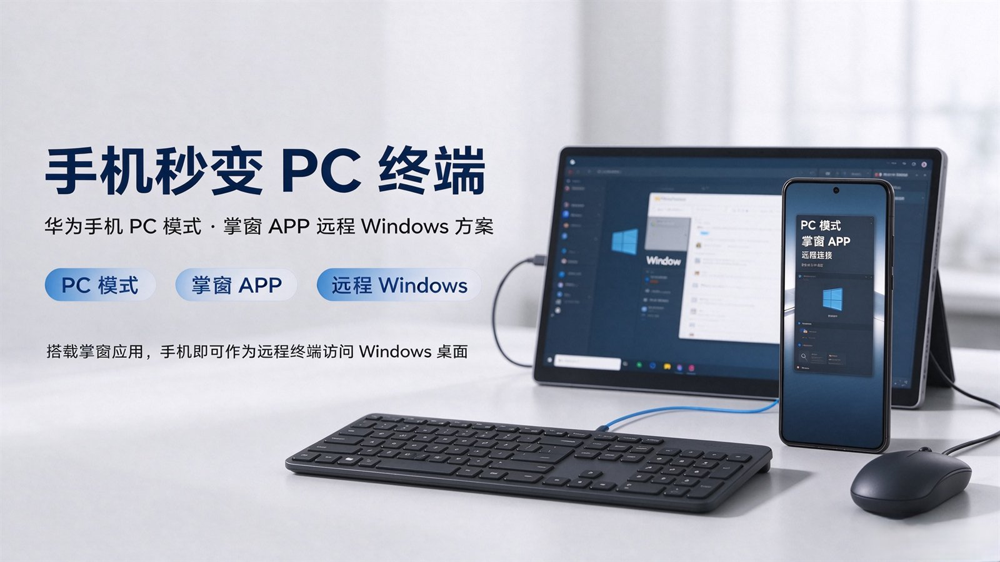
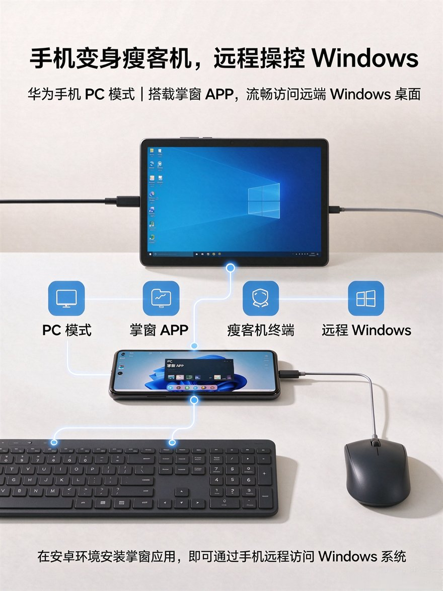
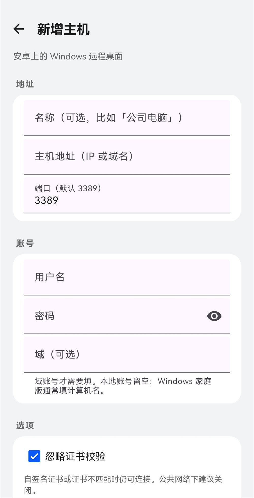
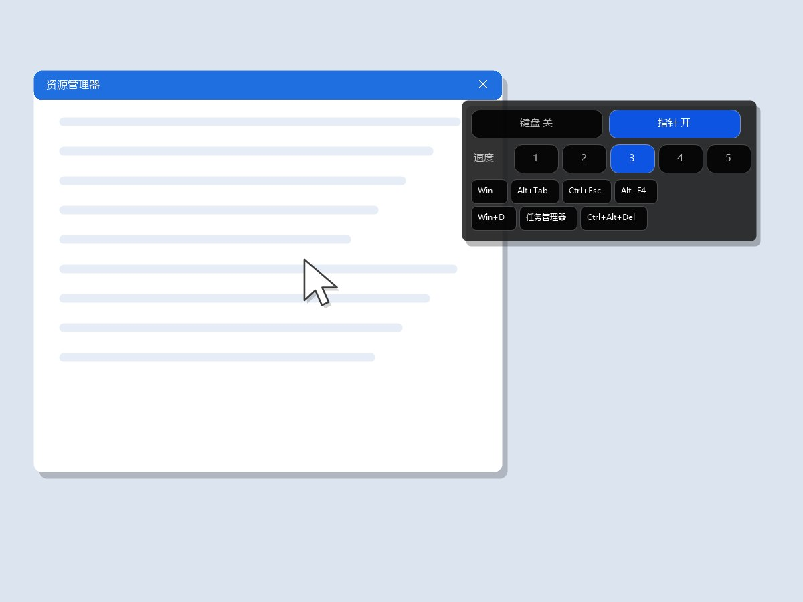
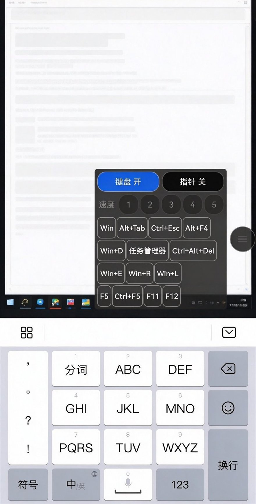

# 掌窗 Palmwin

把安卓手机变成一台 **Windows 远程桌面终端** 的客户端。

插上键盘鼠标、接一块便携屏，手机就是一台瘦客户机；拿在手上，它就是一个能正常打字画图的远程桌面 App。
不是「投屏」，是真正的 RDP 协议客户端——连的是你那台 Windows 机器本身，跑的是它的桌面、它的程序。



## 它解决什么

市面上安卓 RDP 客户端不少，但拿它们连一台真正的 Windows 干活，几乎都会碰到四个问题：

| 问题 | 具体表现 |
|---|---|
| **画面延迟、刷新不及时** | 拖动窗口、滚动网页时一卡一卡，像在远程看着一张不断重新刷新的截图 |
| **画面有锯齿** | 字发虚、边缘毛糙，看久了眼睛疼 |
| **打不了中文** | 手机上输入法打出来的汉字，远端一个字都收不到 |
| **点不中** | 远端界面上那些十几像素的小按钮，手指怎么点都点不上 |

掌窗就是针对这四件事重写的：协议栈直接写系统图形缓冲区（不经中间层拷贝）、按 1:1 渲染不缩放、中文走 Unicode 码点直达、缩放按远端分辨率改而不是把画面放大。

## 怎么用

**两种形态，一套代码**



- **手机模式**：竖屏拿在手里，单指拖动滚动、双击当左键、长按当右键。
- **电脑模式**：华为手机投到显示器/便携屏，接物理键鼠，用起来和 Windows 笔记本一样。物理鼠标的悬停、滚轮、右键菜单全部照常。

**连上去只要三步**



填主机地址、账号、密码。密码可选记住——存的是经过 Android Keystore 加密的密文，密钥不可导出。

**打中文**


软键盘弹出后直接用手机输入法打字，远端正常收到汉字。物理键盘则走扫描码，让远端自己的输入法去组词——两边都对。

**点不中就调缩放**



远端 1 像素在手机上可能只有 1 毫米宽。把显示缩放调到 200% 或 250%，相当于把远端的分辨率调低、字和按钮一起变大，而不是把画面糊着放大。

**工具菜单**



右侧半圆手柄点一下，滑出面板：软键盘开关、指针模式、指针速度、Windows 组合键（Win、Alt+Tab、Ctrl+Esc、Alt+F4、任务管理器、Ctrl+Alt+Del 等）。

**指针模式**

屏幕变成一块笔记本触摸板——手指在哪里推，光标就从哪里移动。适合远端密密麻麻的小图标。

## 它不做什么

这个产品的边界划得很清楚：

- **无账号、无云端、无我们的服务器**。画面、按键、主机地址和密码只在你的手机和你填的那台 Windows 之间流动。
- 不含统计、广告、推送、崩溃收集。
- 不做文件传输、剪贴板同步、音频、多显示器、打印、网关。

一份完整的说明在[隐私政策](privacy-policy.html)。

## 这个仓库是什么

这里**不放应用源码**（闭源商用），只放两样东西：

1. **隐私政策**——应用市场提审要求一个公开可访问的 URL，也是给用户在下载前就能读到的那一份。
2. **开发笔记**——做这个客户端过程中真正踩过的坑，8 篇，见[文章列表](blog/index.html)。

## 目录

```
.
├── index.html              首页
├── privacy-policy.html     隐私政策（与应用内 assets/privacy-policy.html 逐字一致）
├── assets/style.css        全站样式（深浅两套，无外部依赖）
├── img/                    产品图（与 App 内的图同源）
├── blog/
│   ├── index.html          文章列表
│   ├── *.md                文章正文（源文件，改这里）
│   └── *.html              由 md 生成（不要手改）
└── tools/mdgen.js          md → html 生成脚本
```

## 加一篇新文章

1. 在 `blog/` 下新建 `some-slug.md`，写普通的 Markdown：

```markdown
# 标题

> 第一段引用会自动成为页面的 meta description。

## 一节

正文。
```

2. 跑一下生成：

```bash
node tools/mdgen.js
```

3. 在 `blog/index.html` 与 `index.html` 的列表里各加一条链接。

生成器支持：一级到六级标题、段落、粗体、行内代码、有序/无序列表、引用、分隔线、管道表格。不支持代码块高亮、脚注、内嵌 HTML —— 这批文章用不到，为它们引入完整解析器不值得。

## 发布到 GitHub Pages

仓库设置 → Pages → Source 选 `Deploy from a branch`，分支 `main`、目录 `/ (root)`。保存后地址是：

```
https://<用户名>.github.io/<仓库名>/
```

隐私政策就是 `.../privacy-policy.html`，这个地址填到应用市场的提审表单里。

如果国内访问 Pages 不稳定，可以在 Gitee 建一个同名仓库做镜像，或者用任意静态托管把这三个文件放上去。**只要 `privacy-policy.html` 能公开访问即可**，其余是加分项。

## 同步隐私政策

应用内的那份在 `app/src/main/assets/privacy-policy.html`。两份必须逐字一致：一份给已安装的用户在应用内查证，一份给审核员和潜在用户在下载前阅读。

改的时候从应用仓库复制过来，不要各改各的：

```bash
cp ../windows-rdp-android/app/src/main/assets/privacy-policy.html ./privacy-policy.html
```

## 发到 CSDN

CSDN 的编辑器支持直接导入 Markdown。`blog/*.md` 就是为此准备的：不含 YAML front matter、不含相对链接、不含本地图片引用，复制粘贴即可。

一篇一贴，标题用文件里的 `# 标题`。表格与引用块 CSDN 都能正确渲染。

## 许可

文章文字内容与产品图版权归作者所有，转载注明出处。样式与生成脚本随意使用。
