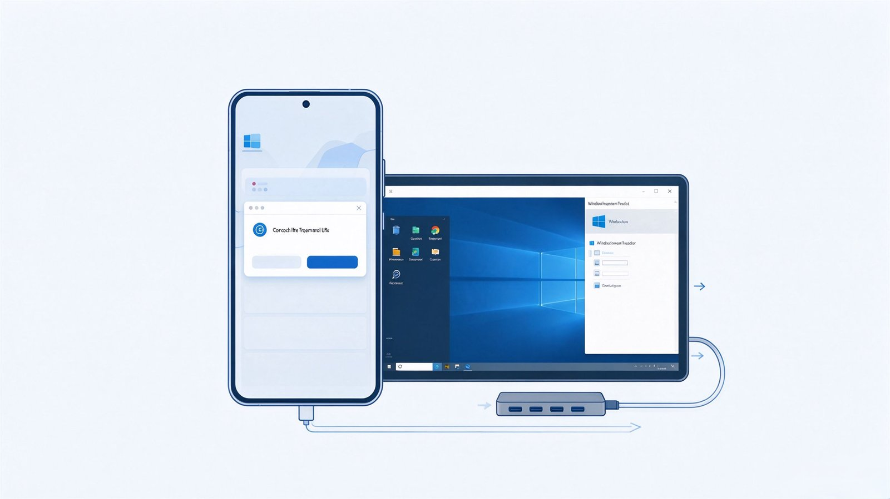
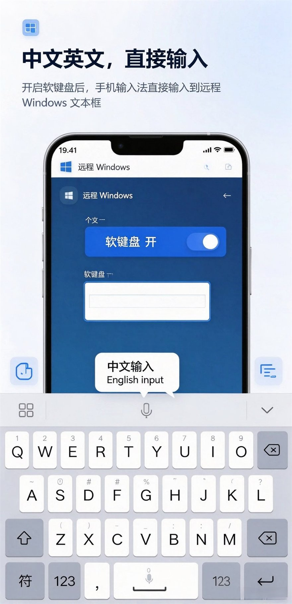

# 掌窗 Palmwin

把安卓手机变成一台 **Windows 远程桌面终端** 的客户端。

插上键盘鼠标、接一块便携屏，手机就是一台瘦客户机；拿在手上，它就是一个能正常打字画图的远程桌面 App。
不是「投屏」，是真正的 RDP 协议客户端——连的是你那台 Windows 机器本身，跑的是它的桌面、它的程序。

## 它解决什么

市面上安卓 RDP 客户端不少，但拿它们连一台真正的 Windows 干活，几乎都会碰到同样四个问题：

| 问题 | 具体表现 |
|---|---|
| **画面延迟** | 拖动窗口、滚动网页时一卡一卡，像在远程看一张不停重新刷新的截图 |
| **画面锯齿** | 字发虚、边缘毛糙，看久了眼睛疼 |
| **打不了中文** | 手机上输入法打出来的汉字，远端一个字都收不到 |
| **点不中** | 远端界面上那些十几像素的小按钮，手指怎么点都点不上 |

掌窗就是针对这四件事重写的：协议栈直接写系统图形缓冲区（不经中间层拷贝）、按 1:1 渲染不缩放、中文走 Unicode 码点直达、缩放按远端分辨率改而不是把画面放大。

## 两种形态

| | |
|---|---|
|  |  |
| **手机模式**：竖屏拿在手里，单指拖动滚动，双击当左键，长按当右键 | **电脑模式**：华为手机接显示器或便携屏，用物理键鼠，和 Windows 笔记本一样 |

电脑模式下，物理鼠标的悬停、滚轮、右键菜单全部照常。手指点击是一套模型，鼠标是另一套，不混着来。

## 怎么用

**连上去只要三步**：填主机地址、账号、密码。密码可选记住——存的是经过 Android Keystore 加密的密文，密钥不可导出、无法离开这台设备；不勾「记住密码」则完全不保存。

<table>
<tr>
<td width="50%"></td>
<td width="50%"></td>
</tr>
<tr>
<td>填地址、账号、密码</td>
<td>软键盘直接用手机输入法打中文</td>
</tr>
</table>

**打中文**：软键盘弹出后直接用手机输入法打字，远端正常收到汉字；物理键盘反过来走扫描码，让 Windows 自己的输入法去组词。两条路各走各的，都对。

**点不中就调缩放**：远端 1 像素在手机上可能只有 1 毫米宽。把显示缩放调到 200% 或 250%，相当于把远端分辨率调低、字和按钮一起变大，而不是把画面糊着放大。

**指针模式**：屏幕变成一块笔记本触摸板，手指在哪里推，光标就从哪里移动。适合远端密密麻麻的小图标。

**工具菜单**：右侧半圆手柄点一下，滑出面板——软键盘开关、指针模式、指针速度、Windows 组合键（Win、Alt+Tab、Ctrl+Esc、Alt+F4、任务管理器、Ctrl+Alt+Del 等）。Win 和 Alt+Tab 这些键在安卓系统层就被吃掉了，只有做成按钮才送得到远端。

## 它不做什么

- **无账号、无云端、无我们的服务器**。画面、按键、主机地址和密码只在你的手机和你填的那台 Windows 之间流动。
- 不含统计、广告、推送、崩溃收集。
- 不做文件传输、剪贴板同步、音频、多显示器、打印、网关。

完整的数据说明见[隐私政策](privacy-policy.html)。

## 这个仓库是什么

这里**不放应用源码**（闭源商用），只放两样东西：

1. **隐私政策** — 应用市场提审要求一个公开可访问的 URL，也是给用户在下载前就能读到的那一份：<https://lilinhai.github.io/palmwin-site/privacy-policy.html>
2. **开发笔记** — 做这个客户端过程中真正踩过的坑，8 篇，见[文章列表](blog/index.html)。

站点首页：<https://lilinhai.github.io/palmwin-site/>

## 开发笔记

- [为什么安卓上的远程桌面会「卡」](blog/why-android-rdp-feels-laggy.html)
- [中文输入为什么是远程桌面的老大难](blog/chinese-input-in-rdp.html)
- [远端 1 像素，不等于你屏幕上的 1 像素](blog/display-scale.html)
- [指针模式：把手机屏幕当触摸板](blog/pointer-mode.html)
- [哪些 Windows 快捷键注定到不了远端](blog/windows-shortcuts-on-android.html)
- [怎么判断「光标在不在输入框里」](blog/cursor-and-editable-field.html)
- [安卓上的悬浮面板：为什么它这么难做对](blog/floating-panel-on-android.html)
- [没有 adb、没有模拟器，怎么开发安卓 App](blog/debug-android-without-adb.html)
